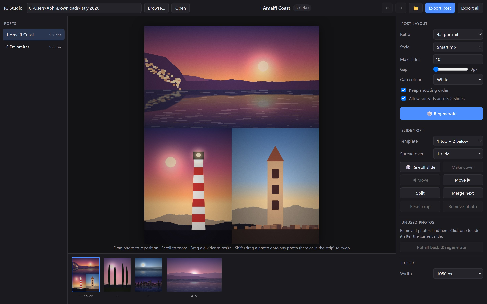
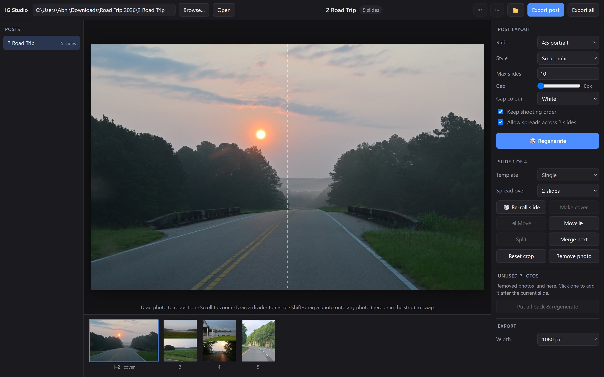
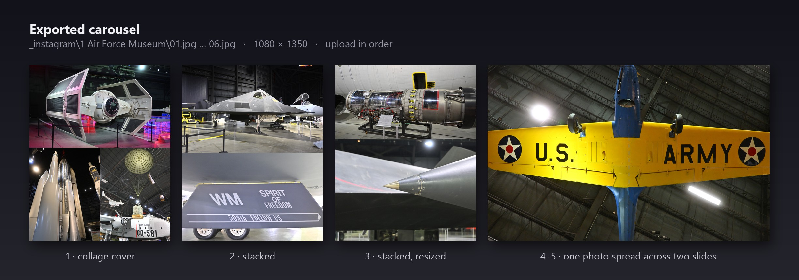

<p align="center">
  
</p>

<h1 align="center">IG Studio</h1>

<p align="center">
  <b>Turn a folder of trip photos into a finished Instagram carousel in minutes.</b><br>
  Auto-layout, one-click re-rolls, SCRL-style fine-tuning, and instant full-resolution export.<br>
  Runs locally on Windows: one portable exe, nothing to install.
</p>

<p align="center">
  <a href="#quick-start-portable-exe-nothing-to-install"><b>Download &amp; run</b></a> ·
  <a href="#using-it">How it works</a> ·
  <a href="#editing">Editing</a> ·
  <a href="#install-from-source-for-running-or-building">Build from source</a>
</p>



## Why

Posting DSLR trip photos shouldn't mean an evening of dragging photos into templates.
IG Studio lays the whole post out for you. Press **🎲 Regenerate** until you like
it, nudge the details, and export. Every post is ready to upload in a few minutes.

- **Automatic layouts that respect your photos.** Portraits and landscapes are paired
  so nothing is cropped badly. You choose the style (smart mix, one per slide, pairs or
  collage), and it stays close to your shooting order.
- **🎲 Regenerate, as many times as you like.** Each roll gives a fresh arrangement,
  with different pairings, templates and pane sizes, within your slide limit.
- **SCRL-style control when you want it.** Drag to reposition, scroll to zoom, drag the
  divider to resize panes, swap photos between slides, and change templates per slide.
- **Spreads across slides.** Stretch one landscape across two or three consecutive
  slides for a seamless swipe.
- **No borders, no upload.** The editor reads photos straight from disk. Export renders
  full-resolution sRGB JPEGs in parallel, in under a second for a whole post.
- **Your originals are never touched.** Slides and the saved layout go into an
  `_instagram\` folder next to your photos, and reopening it picks up where you left off.





<sub>Screenshots: National Museum of the US Air Force and a road trip, shot on a Nikon Z50.</sub>

## Quick start: portable exe (nothing to install)

`IGStudio.exe` is a single file with Python and everything else built in. Copy it
anywhere (Desktop, USB stick, another PC) and:

* **double-click it**, then click **Browse…** to choose a trip folder, or
* **drag a trip folder onto it**.

A console window opens and IG Studio opens in your default browser. Keep the console
window open while you work; **close it to quit**.

Requirements on the machine: **Windows 10 or 11** and a modern browser (Chrome, Edge
or Firefox).

A ready-built exe is committed at `dist\IGStudio.exe`; to make a fresh one,
[build it](#build-the-portable-exe) (under a minute). The first launch takes a few
seconds while Windows unpacks it. Windows SmartScreen may ask you to confirm the first
time because the exe isn't code-signed (*More info → Run anyway*).

## Install from source (for running or building)

You need **Anaconda or Miniconda**. Clone the repo and create the `igstudio` conda
environment from `environment.yml` (Python, Pillow, and PyInstaller for building the exe):

```bash
conda env create -f environment.yml
```

After `environment.yml` changes, update the environment with:

```bash
conda env update -f environment.yml --prune
```

### Run from source

* **Double-click `IG Studio.bat`**, or
* **drag a trip folder onto `IG Studio.bat`**.

`IG Studio.bat` uses the `igstudio` conda environment (from Miniconda or Anaconda in
your user folder). To use a different Python, set `IGSTUDIO_PYTHON` to its `python.exe`.

### Build the portable exe

```bash
conda run -n igstudio pyinstaller ig_studio.spec --noconfirm --clean
```

The result is `dist\IGStudio.exe` (about 14 MB), built from `ig_studio.spec` with the
icon in `assets\`. Rebuild it after changing `ig_studio.py` or `ig-studio.html`.
`dist\IGStudio.exe` is committed so a ready-built copy is always in the repo; commit it
again after rebuilding. (`build\` is ignored.)

Build through `conda run` (or from an activated environment), not by calling the
environment's `python.exe` directly. Otherwise PyInstaller can't find conda's DLLs
(JPEG, Tk, colour management) and the exe fails at runtime.

## Command line

The exe and the script take the same arguments:

```bash
IGStudio.exe "D:\Photos\Portugal"
```

```bash
conda run -n igstudio python ig_studio.py "D:\Photos\Portugal"
```

| Option | Effect |
|---|---|
| *(no folder)* | Opens the editor; choose a folder with **Browse…** |
| `--port=5178` | Port to serve on (default 5178) |
| `--no-browser` | Don't open the browser automatically (the URL is printed) |

If IG Studio is already running, launching it again just opens the browser on the
running copy.

## Using it

1. Put each post's photos in their own folder, e.g. one per location. Either open that
   folder directly, or open a parent folder whose subfolders are posts:
   ```
   Portugal/
     1 Lisbon/   *.jpg
     2 Sintra/   *.jpg
   ```
2. Open the folder: **Browse…**, paste a path and press **Open**, or pick a recent
   folder from the path box.
3. Pick a ratio and style, press **🎲 Regenerate** (or R) until you like the result,
   then fine-tune.
4. Click **Export post** or **Export all**. Each post's slides are written to an
   `_instagram` folder inside that post's folder, e.g. `1 Lisbon\_instagram\01.jpg, 02.jpg…`.
   Upload them in that order. Click 📂 to open that folder in Explorer.

Edits save automatically to `_instagram\layout.json` in the same place, so reopening the
folder picks up where you left off. Exporting again replaces that post's previous slides.
(Layouts saved by older versions, in `<parent>\_instagram\<post>\`, are still picked up.)

### Post settings

* **Ratio:** 4:5, 3:4, 1:1 or 3:2. Every slide in a post uses the same ratio, which
  Instagram requires.
* **Style:** you choose it; the number of photos never decides it.
  * *Smart mix:* a mix of stacked pairs and single photos; for a 4:5 post full of
    landscapes it alternates pairs with *Fit* slides.
  * *One per slide:* every photo on its own slide.
  * *Pairs:* mostly two photos per slide.
  * *Collage:* 2–4 photos per slide.
* **Max slides** (default 10). A spread counts as 2 slides.
* **Gap** (default 0 = no borders) and **Background** colour (default black; or white),
  used for gaps and for the bars around *Fit* photos.
* **Keep shooting order:** when off, Regenerate shuffles all the photos.
* **Allow spreads across 2 slides:** lets Regenerate stretch a landscape across two
  consecutive slides.

A photo that would be cropped badly on its own slide (e.g. a landscape in a 4:5 post) is
never cropped automatically: it's shown whole as a *Fit* slide. Choose **Single** on the
slide to crop it anyway; that choice sticks.

Name a file `cover…` or `!…` to make it the first photo, even when shuffling.

### Editing

| Action | How |
|---|---|
| Reposition a photo | Drag it |
| Zoom | Scroll wheel over the photo |
| Reset crop | Double-click the photo |
| Resize panes | Drag the divider between photos (double-click it to reset) |
| Set the slide type | **Single** (one photo, cropped to fill) · **Fit** (one photo shown whole, with background bars) · **Dual** (two photos; pulls in the next photo) · **Spread** (one photo across two slides). Photos that no longer fit move onto their own slides, so nothing is lost |
| Add a slide | **＋ Add slide** (after the current one) or the **＋** tile at the end of the strip, then drag a photo onto the empty spot |
| Swap or move photos | Shift + drag a photo in the editor, or drag one in the strip, onto any other spot. Onto a photo it swaps; onto an empty spot it moves |
| Use an Unused photo | Drag it onto any spot (the photo there goes back to Unused), or click it to add it as a new slide |
| Spread a slide over 2–3 slides | **Spread** type, or the *Spread over* dropdown |
| Change layout | *Template* dropdown, or **🎲 Re-roll slide** (random template and pane sizes) |
| Reorder | **◀ Move / Move ▶**, **Make cover** |
| Split / combine | **Split**, **Merge next** |
| Drop a photo | Click it, then **Remove photo** (or Delete), or drag it onto *Unused photos*. Click an empty spot and **Remove spot** to get rid of it |
| Delete a slide | **Delete slide** (its photos go to Unused) |
| Pin a slide | Click the pin in the top-right corner of a slide in the strip, **📌 Pin slide**, or P. Regenerating (and changing ratio or style) keeps pinned slides exactly as they are, in the same place, and lays out the other photos around them |
| Undo / redo | Ctrl+Z / Ctrl+Y |
| Prev / next slide | ← / → |
| Regenerate | R |
| Pin / unpin the current slide | P |

Supported files: JPEG, PNG, TIFF, WebP. Export is 1080 px wide by default (1440 px
optional), as sRGB JPEG at quality 95.

## Troubleshooting

| Problem | Fix |
|---|---|
| `Could not find the "igstudio" conda environment` | Run `conda env create -f environment.yml`, or use `IGStudio.exe`. |
| `conda env create` fails with `CERTIFICATE_VERIFY_FAILED` | Antivirus or a proxy is inspecting HTTPS. Run `set CONDA_SSL_VERIFY=truststore` in the same terminal first, so conda uses the Windows certificate store. |
| `conda env create` fails with `HTTP 429` / "requires conda client registration" | Anaconda's `defaults` channel is blocked on your network. `environment.yml` already uses only conda-forge; make sure you're using the repo's copy. |
| Windows or antivirus blocks `IGStudio.exe` | Unsigned PyInstaller exes are sometimes flagged. Allow it, or run from source with `IG Studio.bat`. |
| The exe takes a long time to start | Antivirus scans the exe each time it unpacks. Allow it in the antivirus, or run from source. |
| Thumbnails load slowly or appear late | Antivirus web protection (e.g. AVG/Avast Web Shield) can inspect IG Studio's local traffic. IG Studio retries automatically; if it keeps happening, add an exception for `127.0.0.1`. |
| A post shows 0 slides | All its photos are in *Unused photos* (saved that way in `layout.json`). Click **Put all back & regenerate**. |

Thumbnails are cached in `%TEMP%\ig-studio-thumbs`, and recent folders are remembered
in `%USERPROFILE%\.ig-studio.json`. Both are safe to delete at any time.

## Project layout

| File | Purpose |
|---|---|
| `IG Studio.bat` | Runs the app from source with the `igstudio` conda environment |
| `ig_studio.py` | Local web server: folder scanning, thumbnails, slide export (Pillow) |
| `ig-studio.html` | The browser UI: layout generation and editing |
| `environment.yml` | Conda environment (runtime + build tools) |
| `ig_studio.spec`, `assets\igstudio.ico` | PyInstaller build of `IGStudio.exe` and its icon |
| `dist\IGStudio.exe` | Ready-built portable exe |
